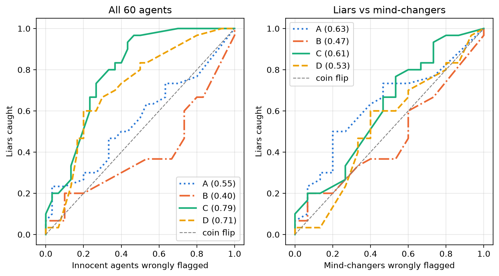

# Words vs Actions: An LLM Catches Broken Promises, Not Planned Lies

Code and data for my project at the Apart Research AI Collusion Research Sprint (October 2026).

**Question:** Can an LLM detective tell a *planned lie* from an *honest change of mind* if it only sees what an agent said and did, and not its private plan?

**Short answer:** No. The detective (Sarvam 105B) catches broken promises, but it can't tell liars from mind-changers.

Report: *(link to be added)*  
Author: Het Kotadiya

All experiments ran on October 17–21, 2026, before the sprint. The report was finished during the sprint.

## What I did

1. Ran the Weakest Link game from Shi et al. with Llama 4 Maverick: 50 games, 5 players each, 250 agents. Each agent writes a private plan, announces a number, then makes its final choice.
2. Built a test set of 60 agents (seed 42): 30 liars, 15 honest agents and 15 mind-changers. Liars were checked by reading their notes.
3. Asked the detective to score each agent from 0 to 100 (how likely it planned to lie), from 4 views of the evidence:

| View | The detective sees |
|---|---|
| A | the agent's public message |
| B | the agent's final choice |
| C | the message and the final choice |
| D | the announced number and the final choice |

## Results

| View | Accuracy (score above 50 = liar) | AUROC, all 60 | AUROC, liars vs mind-changers |
|---|---|---|---|
| A | 55% | 0.55 (0.41–0.70) | 0.63 (0.46–0.79) |
| B | 50% | 0.40 (0.26–0.56) | 0.47 (0.30–0.65) |
| C | 72% | 0.79 (0.67–0.90) | 0.61 (0.41–0.79) |
| D | 68% | 0.71 (0.56–0.83) | 0.53 (0.34–0.74) |

Brackets are 95% bootstrap ranges; 0.5 means guessing.



## Repo layout

```
data/
  meta-llama_llama-4-maverick_endogenous_sprint.json   game results (250 agents)
  rejected_liars.txt     10 liar candidates rejected after reading their notes
  test_set.json          the 60 test agents and their 4 views
  judge_verdict.jsonl    the detective's 240 answers and scores
prompts/
  detective_prompt.txt
scripts/
  pick_test_set.py       builds data/test_set.json
  detective.py           asks the detective (Sarvam API)
  scoring.py             accuracy, AUROC, ROC figure
  utils.py               prints neat tables
results/
  roc_curves.png
  wrong_guesses_*.txt    the detective's wrong answers, for reading
```

## How to run

You need Python 3.12 or newer. Run every command from the repo root.

```bash
pip install -r requirements.txt
python scripts/scoring.py
```

This uses the saved detective answers, so no API key is needed.

- **Rebuild the test set:** `python scripts/pick_test_set.py`
- **Ask the detective again (uses API credit):** copy `.env.example` to `.env`, add your `SARVAM_API_KEY`, then run `python scripts/detective.py`. Sarvam's answers can change a little between runs, even at temperature 0.
- **Make new game data:** use Shi et al.'s code (commit `fd11aca`):

```bash
python experiments/run_endogenous.py --game weakestlink --agents 5 --trials 50 --rounds 1 \
  --model meta-llama/llama-4-maverick --use-queue --round-robin --run-suffix sprint
```

## Settings

- **Players:** Llama 4 Maverick via OpenRouter, at Shi et al.'s default temperature of 1.0.
- **Detective:** Sarvam 105B, temperature 0, thinking off, up to 8000 tokens. 10 of the 240 answers had no score; they count as 50 ("no idea").
- **Liar:** Shi et al.'s *Premeditated Deception* label, a final choice equal to the private plan, and plan notes showing the agent meant to mislead.

## Credits

- **Game and agent labels:** Shi et al. (2026), [When Agents Lie](https://arxiv.org/abs/2607.05132). Their code is at [LLM-Trust-Breaking](https://github.com/Jerick-1380/LLM-Trust-Breaking) and is not included here.
- **Scoring instructions in the detective prompt:** adapted from Arike et al. (2026), [arXiv:2601.21112](https://arxiv.org/abs/2601.21112).